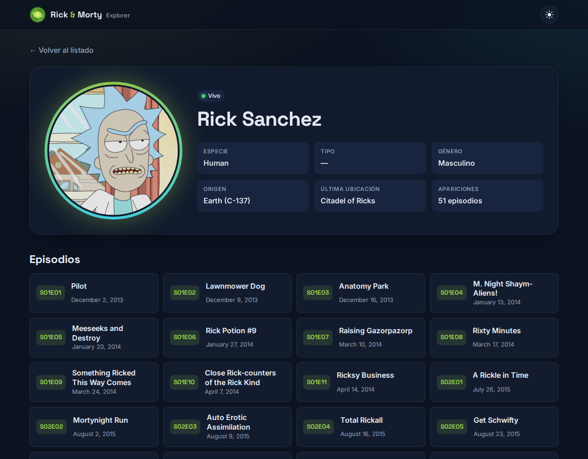

<h3 align="center">Rick and Morty Explorer</h3>

<p align="center">
  Explora todos los personajes del universo de Rick and Morty: búsqueda por nombre, filtros por
  estado y género, paginación y ficha de cada personaje con los episodios en los que aparece.
</p>




<p align="center"></p>

## Demo

[Ver la demo en vivo](https://vichuge.github.io/ReactjsListAndInfo/)

## Funcionalidades

- 🔎 Búsqueda por nombre con *debounce*
- 🎛️ Filtros por estado (vivo, muerto, desconocido) y género
- 📄 Paginación numerada; página y filtros viven en la URL (se pueden compartir y funcionan con atrás/adelante)
- 🧪 Ficha del personaje con datos y lista de episodios
- 🌗 Tema claro / oscuro (respeta la preferencia del sistema y recuerda tu elección)
- 💀 *Skeletons* de carga, estados de error con reintento y estado vacío
- 🔁 Reintentos automáticos y caché en memoria frente al rate-limit de la API
- 📱 Diseño responsive y accesible (navegación por teclado, `aria-*`, *skip link*, `prefers-reduced-motion`)

## Tecnologías

- [React 19](https://react.dev/) + [React Router 7](https://reactrouter.com/)
- [Vite](https://vite.dev/)
- CSS moderno con variables (sin frameworks de UI)
- [Vitest](https://vitest.dev/) + [Testing Library](https://testing-library.com/)
- ESLint

## Desarrollo local

Requiere Node.js 20.19 o superior.

```bash
git clone https://github.com/vichuge/ReactjsListAndInfo.git
cd ReactjsListAndInfo
npm install
npm run dev
```

Abre http://localhost:5173/ReactjsListAndInfo/

| Script            | Descripción                              |
| ----------------- | ---------------------------------------- |
| `npm run dev`     | Servidor de desarrollo                   |
| `npm run build`   | Build de producción en `dist/`           |
| `npm run preview` | Sirve el build de producción localmente  |
| `npm test`        | Ejecuta los tests                        |
| `npm run lint`    | Revisa el código con ESLint              |

## Despliegue

El sitio se publica automáticamente en GitHub Pages con GitHub Actions
([`.github/workflows/deploy.yml`](./.github/workflows/deploy.yml)):

- En cada **pull request** se ejecutan lint, tests y build.
- En cada **push / merge a `master`** además se despliega `dist/` en Pages.

En *Settings → Pages* la fuente debe ser **GitHub Actions**.

## Autor

👤 **Victor Pacheco**

- GitHub: [@vichuge](https://github.com/vichuge)
- LinkedIn: [Victor Pacheco](https://www.linkedin.com/in/victor-pacheco-7946aab2/)

## 🤝 Contribuciones

Contribuciones, *issues* y sugerencias son bienvenidas.

## Agradecimientos

- Gracias a [rickandmortyapi.com](https://rickandmortyapi.com/) por compartir esta API.

## 📝 Licencia

Este proyecto está bajo la licencia [MIT](./LICENSE).
